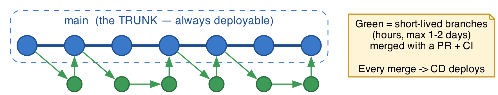
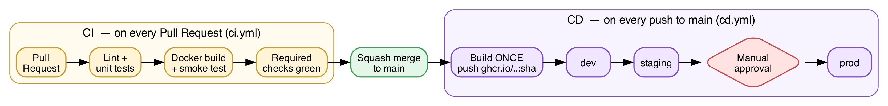
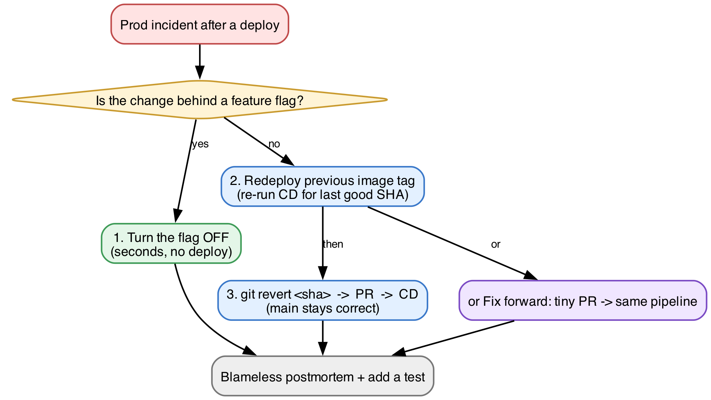

# trunk-based-cicd-reference: trunk-based CI/CD pipeline

A compact reference implementation of **trunk-based development with continuous delivery** on GitHub Actions: protected trunk, required checks, squash-only merges, feature flags, SHA-tagged images promoted through dev → staging → prod with a manual approval gate, and tag-driven releases.



## Pipeline



| Workflow | Trigger | What it does |
|---|---|---|
| `ci.yml` | Pull request to `main` | Lint + unit tests, Docker build + container smoke test, short-lived-branch check |
| `cd.yml` | Push to `main` | Test, build **once**, push `ghcr.io/<owner>/<repo>:<sha>`, deploy dev → staging → **prod (approval required)** |
| `release.yml` | Tag `v*.*.*` | GitHub Release with generated notes |

## Guardrails

- `main` protected: PR required, required status checks, branch up to date, linear history, no force-push or deletion
- Squash-merge only, branches deleted after merge
- `prod` environment with required reviewers. Only one deployment runs at a time (`concurrency`)
- Feature flags (`config/flags.json`, `FLAG_<NAME>` env overrides) so unfinished work merges safely and releases independently of deploys
- Non-root container with health check, `/health` and `/version` endpoints
- Setup is scripted: [`scripts/setup-github.sh`](scripts/setup-github.sh) configures merge settings, environments and branch protection

## Rollback and release strategy

| Situation | Approach |
|---|---|
| Bad feature in prod | Turn the flag off (no deploy) |
| Bad deploy | Redeploy the previous SHA-tagged image, then `git revert` on `main` |
| Hotfix | Small PR through the normal pipeline (fix forward) |
| Patch an older version | Fix on `main` first, then `git cherry-pick -x` into `release/x.y` and tag `vX.Y.Z` |



## Repository layout

| Path | Purpose |
|---|---|
| `app/main.py` | HTTP service (`/`, `/health`, `/version`) with a feature flag |
| `config/flags.json` | Feature-flag defaults |
| `tests/` | Unit tests |
| `Dockerfile`, `Makefile` | Container build and developer commands |
| `.github/` | Workflows, CODEOWNERS, PR template |
| `scripts/` | GitHub setup, branch protection, smoke test, deploy |
| `k8s/deployment.yaml` | Kubernetes manifest for a GitOps (Argo CD / Flux) setup |

## Quick start

```bash
make test        # lint + unit tests
make run         # http://localhost:8080
make build       # docker image tagged with the commit SHA
make smoke       # run the container and check /health

./scripts/setup-github.sh <owner>/<repo>   # configure branch protection + environments
```
